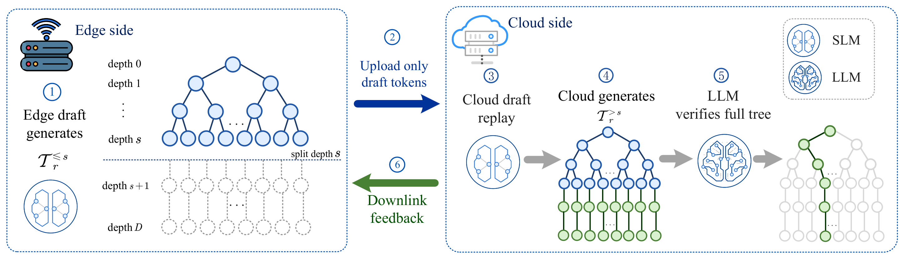
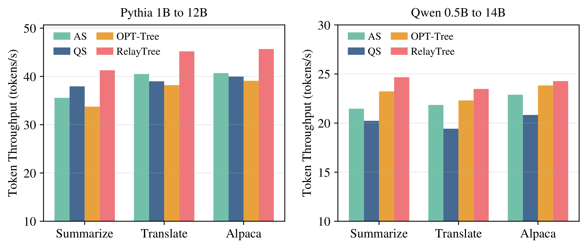

# RelayTree

PyTorch reference implementation of **“RelayTree: Relay-Assisted Tree-Based
Speculative Decoding for Efficient Edge-Cloud LLM Inference.”**

Published in **IEEE Transactions on Vehicular Technology**, 2026.

**[Read the paper on IEEE Xplore](https://ieeexplore.ieee.org/document/11723260)**
| **[DOI: 10.1109/TVT.2026.3740714](https://doi.org/10.1109/TVT.2026.3740714)**
| **[Quick start](#installation)**
| **[Citation](#citation)**

First author: **Tingyue Xue** · [Google Scholar](https://scholar.google.com/citations?user=2aA4PVMAAAAJ) · [Semantic Scholar](https://www.semanticscholar.org/author/2361225201)

**Tree-based speculative decoding for LLM inference over bandwidth-limited
edge-cloud links.** RelayTree splits draft-tree generation between an edge
small language model (SLM) and the cloud. The edge sends prefix token IDs;
a cloud-side SLM replica replays those tokens to recover the draft state,
completes the tree, and passes it to the target LLM for verification.
This lets the system share drafting work across the edge and cloud while
keeping the prefix uplink payload small.

## How RelayTree Works

[](plotresult/figure_02_relay_framework.pdf)

*Figure 2 from the paper: relay-assisted tree generation. Click the figure for
the original PDF.*

The split depth **s** controls how much of the tree is drafted at the edge.
Cloud replay reconstructs the SLM state from the received prefix tokens before
the remaining tree is generated. The target LLM then verifies the candidates
and extends the output sequence. The reference implementation also supports
all-cloud and full-edge drafting.

## Core Results

**RelayTree achieves the highest token throughput among the four methods in
all six task/model comparisons shown below.** The paper evaluates summarization,
translation, and instruction following using Pythia-1B/12B and Qwen2.5-0.5B/14B.

[](plotresult/figure_03_throughput_comparison.pdf)

*Figure 3 from the paper. Q = 96 and 5 Mbps uplink for the edge-cloud schemes.
Higher throughput is better; the vertical axes have nonzero baselines and
different ranges. Click the figure for the original PDF.*

### Relay deployment tradeoff

The following excerpt from **Table II** compares relay deployment schemes on
Alpaca. We show **RelayTree (s=1)** alongside the all-cloud and full-edge
baselines; the paper includes the additional s=2 configuration.

| Scheme | LLM verify<br>(fw/token) | Cloud SLM<br>(fw/token) | Uplink overhead<br>(bits/token) | Uplink latency<br>(ms) | Peak cloud memory<br>(GB) | Throughput<br>(tokens/s) |
|:--|--:|--:|--:|--:|--:|--:|
| All-cloud (s=0) | 0.3503 | 1.0508 | 0.00 | 0.00 | 24.70 | 50.13 |
| **RelayTree (s=1)** | **0.3503** | **0.7006** | **16.81** | **2.15** | **24.79** | **48.35** |
| Full-edge | 0.3680 | 0.0000 | 3360.40 | 430.13 | 22.71 | 38.74 |

*Values are reproduced from Table II of the [paper](https://ieeexplore.ieee.org/document/11723260).
fw/token denotes model forward passes per generated token. Bold identifies
the selected RelayTree configuration, not the best value in each column.*

RelayTree (s=1) reduces uplink overhead by **99.5%** relative to full-edge
drafting and uses **about one-third fewer cloud-side SLM forward passes** than
all-cloud drafting. Its throughput is **48.35 tokens/s**, compared with 38.74
for full-edge and 50.13 for all-cloud, showing the communication-computation
tradeoff.

Performance depends on temperature and deployment: QS is faster at low
temperatures in [Figure 4](plotresult/figure_04_temperature_sweep.pdf), while
the all-cloud configuration has the highest throughput in the deployment
comparison in [Figure 5](plotresult/figure_05_relay_deployment.pdf).
See the [paper](https://ieeexplore.ieee.org/document/11723260) for the full
experimental conditions and analysis.

## Structure

```text
run.py                    example and benchmark entry point
relaytree/sampling/       RelayTree, QS, and autoregressive decoding
relaytree/inference/      tree construction, replay, and verification
relaytree/models/         Pythia and Qwen2 Tree-Attention backends
plotresult/               original framework and simulation figures
docs/assets/              previews of original paper figures
```

## Paper Figures

The original framework and simulation-result figures are available as PDFs:

- [Figure 2: Relay-assisted tree generation](plotresult/figure_02_relay_framework.pdf)
- [Figure 3: Throughput comparison](plotresult/figure_03_throughput_comparison.pdf)
- [Figure 4: Temperature sweep](plotresult/figure_04_temperature_sweep.pdf)
- [Figure 5: Relay deployment](plotresult/figure_05_relay_deployment.pdf)

## Installation

```bash
pip install -r requirements.txt
```

The implementation was tested with Python 3.11, PyTorch 2.7.0, Transformers
4.47.0, and an NVIDIA A100 GPU.

## Example

The default command uses Pythia-1B/Pythia-12B, tree shape `(3,1,1)`, `Q=96`,
temperature 1.0, and a 5 Mbps uplink:

```bash
python run.py --task custom --input "Explain speculative decoding." --num_eval 1
```

Run the relay scheme with a split after the first tree depth:

```bash
python run.py \
  --task custom \
  --input "Explain speculative decoding." \
  --num_eval 1 \
  --scheme relay \
  --tree_k 3,1,1 \
  --relay_split_depth 1 \
  --q_level 128
```

Use `python run.py --help` for other model, dataset, tree, and communication
options. The supported paper tasks are CNN/DailyMail summarization, WMT14
German-to-English translation, and Alpaca instruction following.

The benchmark prints average throughput in tokens per second. Generated result
files, downloaded models, and dataset caches are intentionally not included.

## Models

The code supports the model pairs evaluated in the paper:

- `EleutherAI/pythia-1b` → `EleutherAI/pythia-12b`
- `Qwen/Qwen2.5-0.5B` → `Qwen/Qwen2.5-14B`

Models and datasets are downloaded from Hugging Face and are not included in
this repository.

## Citation

If you use RelayTree in your research, please cite the paper below. You can
also use GitHub's **Cite this repository** button to copy the citation.

```bibtex
@article{xue2026relaytree,
  title   = {RelayTree: Relay-Assisted Tree-Based Speculative Decoding for Efficient Edge-Cloud LLM Inference},
  author  = {Xue, Tingyue and Li, Hanlei and Zhang, Guangyi and Hou, Qiushuo and Cai, Yunlong and Yu, Guanding},
  journal = {IEEE Transactions on Vehicular Technology},
  year    = {2026},
  pages   = {1--6},
  doi     = {10.1109/TVT.2026.3740714},
  url     = {https://ieeexplore.ieee.org/document/11723260}
}
```

## License

This project is released under the Apache-2.0 License.
